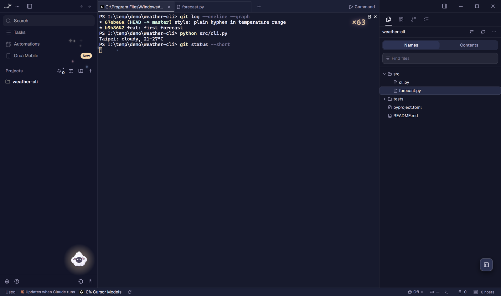
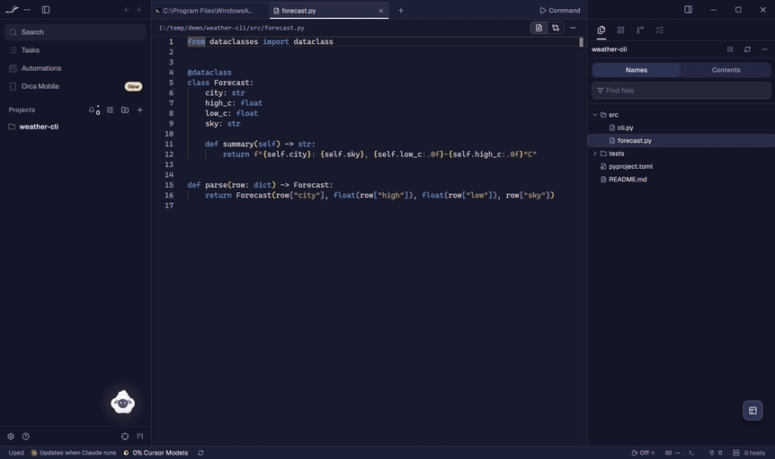
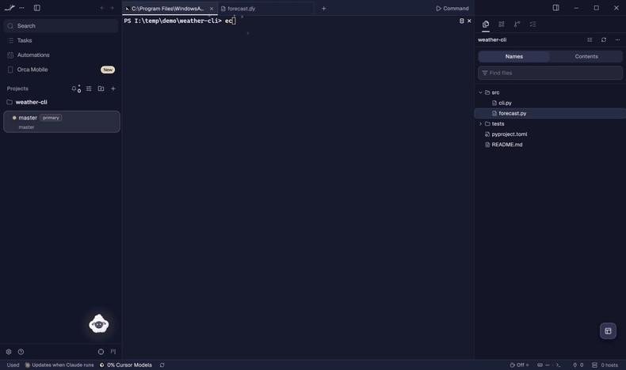
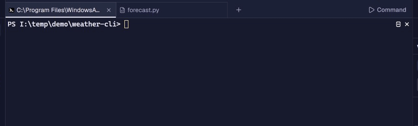
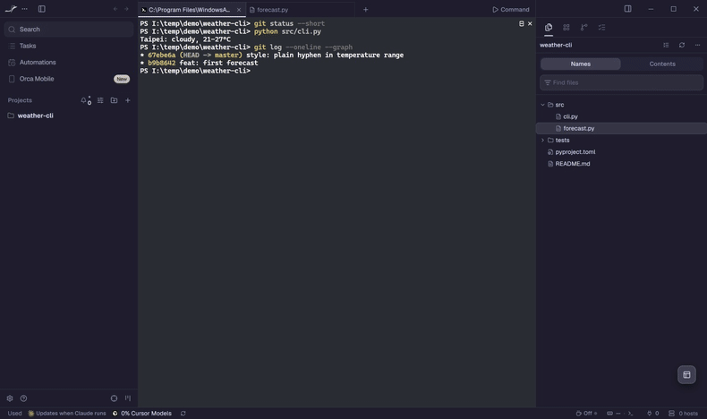
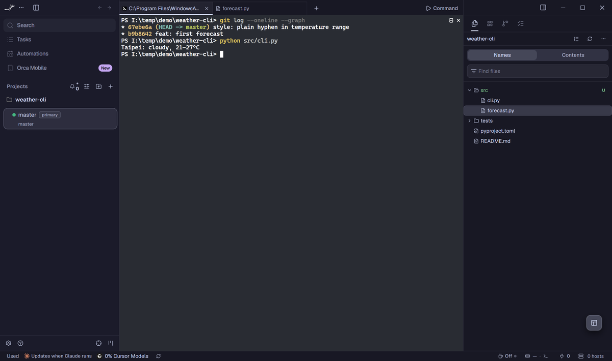
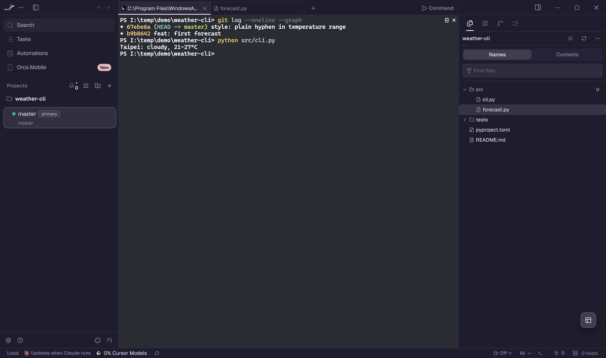
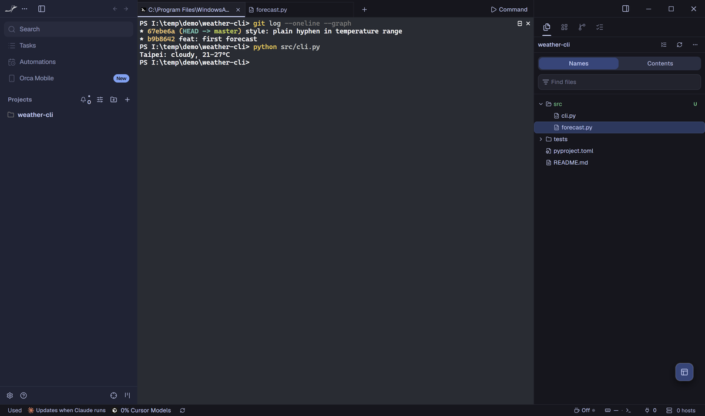

# Orca Companion Kit

讓 AI agent（Claude Code、Codex……）幫你做一套自己的 [Orca](https://github.com/stablyai/orca) 外觀：主題配色、會陪你寫程式的桌面小寵物、自訂游標，必要時再加終端機配色和通知音效。做好的東西只會放在你的電腦裡（`~/.orca/themer/`），Orca 更新後照樣能用。



<sub>Orca 實際畫面：範例主題「棉花夜空 Cotton Sky」加上範例寵物 Puff。專案是另外建的示範資料夾。</sub>

## 實際畫面

以下都是照「快速開始」裝好之後，在 Windows 版 Orca 裡錄的。

| | |
| --- | --- |
|  |  |
| **摸摸、甩出去。** 游標在 Puff 身上來回摸會冒愛心；用力甩出去，它飛一段再自己走回家。 | **會回話、會跟著走。** 終端機送出的字裡有它認得的詞（這裡是 lunch），它會回一句。雙擊它就跟著游標走，按右鍵讓它停下。 |
|  |  |
| **打字特效。** 終端機打字時從游標迸出小火花，右上角算連擊數，停手一陣子就淡掉。 | **Ctrl+Alt+T 換主題。** 點一下就換，不用重開 Orca。換完視窗會自己重新載入一次，讓終端機配色跟上（錄影裡剪掉了這一段）。 |

**位置和大小都能換。** 把寵物拖到任何地方、慢慢放下，那裡就是它的新家；滾輪可以縮放（0.5–2.5 倍）。兩者都會記住，下次開 Orca 還在原位。想換預設位置，在寵物設定寫 `home`（見 [companion-api.md](docs/companion-api.md)）。

另外附了三套經典主題，可以直接用，也可以拿來當範本改：

| Catppuccin Mocha | Rosé Pine | Tokyo Night |
| --- | --- | --- |
|  |  |  |

<sub>錄影抓不到系統游標，動圖裡的游標是事後依實際指標位置疊上去的，用的就是棉花夜空的自訂游標圖（`examples/cursors/cotton-pointer.svg`）。動作是用腳本送進 Orca 的指標和按鍵事件，Puff 的反應都是它自己的程式跑出來的。</sub>

## 它做了什麼

- **不動 Orca 的安裝檔。** 啟動器用 `--remote-debugging-pipe` 開 Orca。這條私有管線只有啟動器拿得到，不開任何網路埠。主題 CSS 和小巧思（touches）都經由它，在每個 Orca 視窗載入前注入。
- **存檔就生效。** 改了 `~/.orca/themer/` 裡的主題或 touch，視窗會立刻重新套用。
- **Orca 更新後照常運作。** 安裝程式只會把捷徑改回 Orca.exe，啟動器每次啟動、Orca 關閉後都會再把它們指回來。
- **你的東西不放在這個 repo 裡。** 主題、寵物、游標都在 `~/.orca/themer/`，`git pull` 不會蓋掉。

## 快速開始（Windows）

需要 Node.js 20 以上，以及裝在預設位置（`%LOCALAPPDATA%\Programs\orca`）的 Orca。

```powershell
git clone <this repo> orca-companion-kit
cd orca-companion-kit
npm install
.\install.ps1          # 桌面、開始選單、工作列的 Orca 捷徑改成經由啟動器開
npm run example        # 範例主題「棉花夜空」和範例寵物 Puff 放進 ~/.orca/themer
```

接著從捷徑開 Orca，按 **Ctrl+Alt+T**，選「棉花夜空 Cotton Sky」。

> 啟動器會先關掉正在跑、但沒經過啟動器的 Orca（Orca 同一時間只能開一個），再重新開。想先試試、不動到現在的 Orca，可以用獨立的設定資料夾跑：
> `node src/themer.mjs --user-data-dir=%TEMP%\orca-trial`（這種試跑不會關掉原本的 Orca，也不會改捷徑）。

還原：`.\uninstall.ps1` 會把捷徑換回原本的樣子；`~/.orca/themer` 裡的東西會留著。

## 讓 AI 幫你做

在這個資料夾開 Claude Code（或任何會讀 `AGENTS.md` 的 agent），說一聲：

> 幫我做一套 Orca 主題和一隻桌面寵物。

agent 會先問你幾件事：參考圖、配色、角色個性、招牌動作。接著產生主題 CSS、終端機配色、游標、寵物的 SVG 和設定，全部寫進 `~/.orca/themer/`，最後跑 `npm run check` 確認沒有踩到效能陷阱。整個流程寫在 [`docs/ai-guide.md`](docs/ai-guide.md)。

## 還能自己加什麼

範例只是起點。以下都能自己寫，或直接請 agent 幫你做：

- **寵物的個性。** 台詞、它認得的關鍵字（`words`）、聽到名字時的反應（`names`）、招牌動作和新的動作（`acts`）、要慶祝的紀念日（`milestones`）。內建的反應也能整個換掉。見 [companion-api.md](docs/companion-api.md)。
- **全新的小功能。** 寵物之外，任何在 Orca 視窗裡跑的效果都可以寫成一個 touch：聚焦光暈、閒置畫面、狀態列裝飾、通知音效……放進 `~/.orca/themer/touches/`，主題列上它的 id 就會啟動，也能在 Ctrl+Alt+T 選單裡單獨開關。見 [touches.md](docs/touches.md)。
- **可以疊加的樣式片段。** 小段 CSS（例如更圓的邊角）放進 `snippets/`，跟任何主題一起用。見 [themes.md](docs/themes.md#片段snippets)。
- **修 Orca 的小毛病。** 不改安裝檔，在執行期替換 Orca 的程式片段。見 [fixes.md](docs/fixes.md#寫新的修正)。

寫完跑 `npm run check`，它會抓出已知會讓 Orca 變慢的寫法（[performance.md](docs/performance.md)）。

## 文件

| 文件 | 內容 |
| --- | --- |
| [docs/ai-guide.md](docs/ai-guide.md) | 給 agent 的工作流程：訪談、產出清單、提示詞範本、驗收 |
| [docs/themes.md](docs/themes.md) | 主題檔格式、Orca 的 CSS 變數、DOM 掛點、終端機配色、游標、音效 |
| [docs/companion-api.md](docs/companion-api.md) | `registerCompanion` 完整參考 |
| [docs/touches.md](docs/touches.md) | `registerTouch` 與執行環境 API |
| [docs/performance.md](docs/performance.md) | **效能守則**，每一條都是實際量到的延遲 |
| [docs/install.md](docs/install.md) | 安裝、開機啟動、撐過 Orca 更新的原理、疑難排解 |
| [docs/fixes.md](docs/fixes.md) | 選用的執行期修正（預設關閉） |

## 指令

```powershell
npm test               # 單元測試
npm run check          # 檢查 ~/.orca/themer 裡的主題和 touch（效能陷阱、語法）
npm run check -- --repo
npm run example        # 複製範例到 ~/.orca/themer
npm run cursor -- my-cursor.svg 2 2   # SVG 轉成游標 CSS（1x/2x、熱點）
npm run chime -- ~/.orca/themer/sounds/my-theme.wav 1046.5 1318.5
```

## 版權與素材

程式碼採 MIT 授權。範例角色 Puff、範例主題和游標都是為這個專案原創的，可以自由改作。替自己做寵物時，請用你有權使用的素材：自己畫的、AI 依你的描述生成的，或授權允許的。

---

## English

**Orca Companion Kit** lets an AI agent build your own theme, desktop companion pet and custom cursor for the Orca IDE. Everything is injected over a private CDP pipe (`--remote-debugging-pipe`, no network port) and Orca's install is never modified, so your setup survives Orca updates. Your creations live in `~/.orca/themer/`, outside this repo.

```powershell
npm install; .\install.ps1; npm run example   # then open Orca from its shortcut, Ctrl+Alt+T
```

Open an agent in this folder and ask it to "make me an Orca theme and a desktop pet": `AGENTS.md` tells it how to interview you and what to generate. Drag the pet anywhere and drop it gently to give it a new home; the mouse wheel resizes it, and both are remembered. Beyond the pet, you can write your own touches (any effect that runs in an Orca window), stackable CSS snippets and runtime fixes. API reference: `docs/companion-api.md`, `docs/touches.md`. Read `docs/performance.md` before writing any CSS or touch: each rule there comes from a measured slowdown in Orca. Windows only for now (the launcher and shortcut handling use Windows paths and PowerShell).
