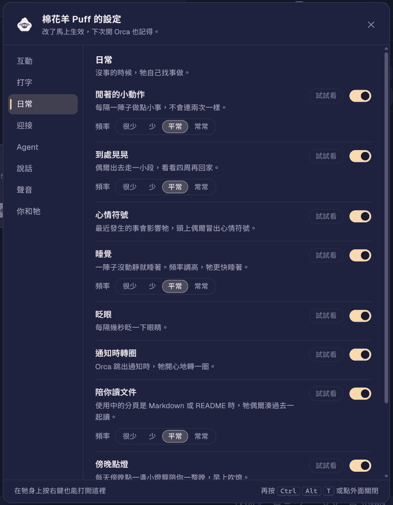

# 寵物 API：`registerCompanion`

`src/touches/companion.js` 是共用的寵物引擎。一隻寵物只需要一個檔案：一張 SVG、幾個部位的選擇器、幾句台詞和自己的動作。完整範例：[`examples/touches/puff.js`](../examples/touches/puff.js)。

```js
;(() => {
  const T = window.__orcaThemer
  if (!T?.registerCompanion) return
  T.registerCompanion({
    id: 'my-pet',            // touch id: list it in your theme's @touches
    label: '我的寵物',
    svg: `<svg viewBox="0 0 120 120">…<g class="my-eyes">…</g></svg>`,
    parts: { eyes: '.my-eyes' },
    lines: { idle: ['今天也一起加油。'] }
  })
})()
```

## 它會自己做的事

不必寫任何程式，每隻寵物都會：

| 行為 | 細節 |
| --- | --- |
| 拖曳、甩出去 | 放手時速度夠快就甩出去，有慣性、撞到視窗邊緣會反彈，暈一下之後飄回家。慢慢放下，那裡就是牠的新家 |
| 滾輪縮放 | 0.5–2.5 倍，會記住 |
| 雙擊跟著你 | 跟在游標後面，留下一道軌跡。**右鍵任何地方**可以停下，Esc 不會（Esc 會中斷 Claude Code） |
| 看你的游標 | 游標靠近時，眼睛和身體會轉過去 |
| 跟著打字搖晃 | 聽 `keydown` 和 `compositionupdate`（輸入法），每 150 ms 最多晃一次 |
| 心情 | happy、curious、bored、sleepy、worried，每 30 秒衰減一次；最強的心情會影響閒置動作，偶爾在頭上冒出符號 |
| 閒置動作 | 每 12–30 秒依心情加權挑一個，不會連續重複同一個 |
| 被嚇到 | 游標快速掠過身邊時（每 20 秒最多一次） |
| 歡迎回來 | 離開超過 10 分鐘再回到 Orca 時 |
| 睡覺 | 一陣子沒有操作就睡著，眼睛換成睡眼，冒出 z；有任何操作就醒來 |
| agent 分頁 | agent 工作中，光暈會呼吸；有分頁在等你授權時，牠會飛去那個分頁旁邊敲門，點牠就切過去；做完會轉圈，失敗會垂頭 |
| 聽你送出的那一行 | 只看終端機裡按 Enter 送出的那一行，判斷好消息、道謝、累了、bug、問題。像「沒有 bug」這種否定句會算好消息。這一行只存在記憶體裡，按下 Enter 就丟掉，不會儲存或送到任何地方 |
| 一直刪字 | 2.5 秒內按 8 次 Backspace，牠會歪頭看你 |
| 摸摸牠 | 游標在牠身上來回移動 |
| 說話 | 對話框一個字一個字打出來。閒置台詞至少間隔 6 分鐘，任何台詞至少間隔 45 秒，一天最多 12 句 |
| 心情和感情 | 心情、好感、親密、不安、寂寞五個數字，跨小時到跨月，見下方[心情](#心情)。設定面板第一個分頁「心情」看得到；心情跌到谷底時牠會鬧彆扭，摸三下就和好 |
| 記得你們的日子 | 一起過了幾天、第 7／30／100／200／365… 天會慶祝、依時段打招呼、比你平常晚很多還在用時會擔心你。全部只存在 localStorage |
| 右鍵 | 打開牠的[設定面板](#設定面板)（跟著你的時候，右鍵是讓牠停下） |
| 點一下 | 戳戳牠；在敲門時點牠，會切到那個分頁（用真的 pointerdown／mouseup 事件，因為 Orca 在 pointerdown 就切分頁，只送 `click()` 不會動） |
| 唱歌 | 送出的那一行有「唱歌」「搖籃曲」、`sing`、`lullaby`，牠就唱：晃來晃去、冒音符。設了 `sing` 又放了你自己的音檔，就會放那段音樂（見下方「用自己的音檔唱歌」） |

在系統設定「減少動態」時，牠不會出現，因為執行環境不會啟動任何 touch。

### 要自己打開的行為

下面這些預設關著，在設定裡寫 `true`（或一個選項物件）才會有。Puff 全都開了，可以拿來看效果。使用者也可以在[設定面板](#設定面板)自己打開或關掉；寵物設定裡寫的只是預設值。

| 設定 | 牠會做什麼 | 選項 |
| --- | --- | --- |
| `hideAndSeek` | **捉迷藏。** 點牠一下就消失，躲到視窗裡某個邊緣後面：分頁列下緣、worktree 側欄右緣、檔案樹左緣、狀態列上緣、分割窗格的分隔線、通知卡片上緣，或視窗四邊。一開始只露頭頂，越久沒被找到越大膽：露出眼睛、探頭張望、飄出 ✦ 或「嘻」當提示。游標靠近就縮回去，離開一會兒再探出來。點到牠就是找到了（`lines.found`），45 秒沒找到牠就自己得意地出來（`lines.notFound`）。不會躲在游標底下或你正在打字的地方；有分頁在等你授權時會先收掉遊戲 | `{ giveUpAfter: 45000, click: true }`：多久放棄；`click: false` 表示點一下仍是戳戳，只能用 `api.hide()` |
| `git` | **git 反應。** 終端機送出的那一行是 `git commit`，牠在旁邊蓋一個印章；`git push` 就折一架紙飛機扔向右上角。串在一起（`git add . && git commit && git push`）以最後一個為準；引號裡的字不算（`echo "git push"` 沒反應）；`--dry-run`、`--help` 不算 | 覆蓋 `reactions.gitCommit`、`reactions.gitPush` 換成自己的動作 |
| `caught` | **被抓包。** 離開超過 `welcomeAfter` 再回來，有六成機率撞見牠在做自己的事（預設是玩星星雜耍），牠嚇一跳、把東西藏起來、臉紅、說一句 `lines.caught`，再安靜地接上歡迎。30 分鐘最多一次 | `{ chance: 0.6, cooldown: 1800000, scenes: ['juggle', 'myScene'] }`：`scenes` 是動作名稱，該動作的 `run` 要**回傳一個收拾函式**（把道具拿掉），見 Puff 的 `nibble` |
| `nuzzle` | **蹭蹭。** 游標停在牠身上不動 2.5 秒，牠整個人靠過去來回蹭三下，冒大愛心。和來回摸摸是兩件事，90 秒冷卻 | `{ after: 2500, cooldown: 90000 }` |
| `readAlong` | **一起讀。** 使用中的分頁是 `.md`／README 時，牠偶爾朝編輯器方向微傾、慢慢點頭讀起來；畫裡有 `parts.glasses`（平常隱藏）就會戴上眼鏡。8 分鐘最多一次，換分頁、被拖走、睡著或讀滿 45 秒就停 | `{ every: 480000, for: 45000, chance: 0.5 }` |
| `lantern` | **提燈。** 每天 18 點後第一次在家就點亮一盞小燈籠，暖光緩緩呼吸，陪一整晚（`lines.lantern`）；以 05 點換日，早上吹熄。點燈日記在 bond 裡，重新載入只會安靜補回燈 | `{ from: 18, until: 5, svg: '<svg>…</svg>' }`：換時段，或換成自己畫的燈 |

這些動作一樣只動 `transform`／`opacity`，位置只在開始時量一次，不在每一格讀版面。

## 設定

| 欄位 | 型別 | 說明 |
| --- | --- | --- |
| `id` | string | **必填**。touch id，同時用在 localStorage key |
| `svg` | string | **必填**。SVG 字串；`<defs>` 裡的 id 請加上寵物名稱當前綴，避免撞名 |
| `label` / `description` | string | 選單上顯示的名稱與說明 |
| `title` | string | 滑鼠停在牠身上時的提示文字 |
| `size` | number | 畫出來的像素大小，預設 64 |
| `parts` | object | 部位名稱對應選擇器，見下表 |
| `colors` | object | `sparkle`、`heart`、`note`、`alert`、`calm`、`dim`、`trail`：特效和符號的顏色 |
| `glow` | string \| false | 身後光暈的顏色（CSS 顏色），`false` 表示不要光暈 |
| `sounds` | object \| false | 合成鈴聲的頻率（Hz），可設 `pet`、`welcome`、`follow`、`star`，另有 `gain`（音量倍率）；`false` 表示完全靜音 |
| `home` | `({width,height,box}) => {x,y}` | 預設位置（使用者還沒拖動過之前） |
| `signature` | string | 招牌動作的名稱（放下、跟隨結束、甩完回家時做），預設 `wiggle` |
| `acts` | object | 自己的動作；可以新增、覆蓋，或設成 `null` 拿掉內建動作 |
| `reactions` | object | 覆蓋內建反應（見下方） |
| `words` | `[{ re, react }]` | 送出的那一行符合 `re` 時觸發 `react`（動作或反應的名稱，或 `(api) => …`）。會在內建關鍵字之前檢查 |
| `defaultWords` | boolean | `false` 表示不要內建的中英文關鍵字 |
| `names` | string[] | 牠的名字；出現在送出的那一行時，牠會開心地回應（`lines.name`） |
| `lines` | object | 台詞，見下方。沒有台詞的寵物不會說話 |
| `milestones` | number[] | 要慶祝的天數，預設 `[7, 30, 100, 200, 365, 500, 1000]` |
| `emotes` | object | 新增或覆蓋頭上冒出的符號：`{ happy: ['♡', '#f6b3c8'] }`。內建：`happy`、`curious`、`bored`、`sleepy`、`worried`、`surprised`、`giggle`（躲著偷笑）、`smug`（沒被找到）、`blush`（被抓包） |
| `idleEvery` | `[min, max]` ms | 閒置動作的間隔，預設 `[12000, 30000]` |
| `sleepAfter` | ms | 多久沒操作就睡著，預設白天 90 秒、晚上 120 秒 |
| `welcomeAfter` | ms | 離開多久回來才算「歡迎回來」，預設 10 分鐘 |
| `sing` | `{ asset, start, length, volume }` | 唱歌時放的音檔：`asset` 是 `~/.orca/themer/assets/<主題 id>/` 裡的檔名（不含副檔名），`start` 從第幾秒開始、`length` 放幾秒（預設 20）、`volume` 0–1（預設 0.35）。沒設或找不到檔案就只冒音符 |
| `hideAndSeek`、`git`、`caught`、`nuzzle`、`readAlong`、`lantern` | boolean \| object | 要自己打開的行為，見上方 |
| `blink` | boolean | `false` 表示不眨眼 |
| `eyeTravel` | `[x, y]` | 眼睛看向游標時最多移動多少，預設 `[2.2, 1.6]` |
| `visitTabs` | boolean | `false` 表示不去敲等待授權的分頁 |
| `trail` | boolean | `false` 表示跟隨時不留軌跡 |
| `bubbleStyle` | string | 附加在對話框上的 CSS |
| `behaviors` | `[{ id, label, desc, section?, freq?, default?, preview? }]` | 寵物自己的行為，會出現在設定面板，見下方「設定面板」 |
| `sections` | `[{ id, label, intro }]` | 設定面板新增的分頁，給 `behaviors` 的 `section` 用 |
| `emotion` | `{ words, transitionSpeed }` \| false | 心情用的字（好感階段、親密階段、心情、想著的事）和心情變化的快慢，見下方[心情](#心情)；`false` 表示這隻寵物沒有心情系統，也沒有「心情」分頁 |
| `onStart(api)` / `onStop(api)` | function | 啟動和停止時各呼叫一次。自己加的監聽器請在 `onStop` 移除 |

### 部位 `parts`

值可以是選擇器字串，或 `{ sel, origin }`。每個元素都會設定 `transform-box: fill-box`，旋轉基準點優先順序是：元素上的 `data-origin`，然後 `origin`，然後預設值。

`flutter`、`ears`、`eyes` 這三種會一直動或跟著游標動的部位，請畫成 `<svg>` 的**直接子元素**（一個 `<g>`）。引擎啟動時會把它們各自抽成一層 HTML 方塊（裡面是一張同 `viewBox`、只放該部位的 SVG），疊回原本的順序，支點照它的外框和 `origin` 算；這樣循環動畫才能交給合成器跑，不然每一格都會把整張圖重畫（[performance.md](performance.md) 第 14、15 條）。巢狀在別的群組裡的部位仍然能動，只是留在 SVG 裡、吃主執行緒。

| 名稱 | 引擎怎麼用 |
| --- | --- |
| `eyes` | 眨眼（scaleY）、看向游標（translate） |
| `happyEyes` | 開心時取代 `eyes`（平常隱藏） |
| `sleepEyes` | 睡覺、打瞌睡時取代 `eyes` |
| `ears` | 待機時輕擺，被嚇到、甩耳朵、環顧四周時會動。左右耳各自用 `data-origin` 設定支點 |
| `flutter` | 待機時一直輕輕伸縮（翅膀、毛、尾巴） |
| `glasses` | 平常隱藏，開了 `readAlong` 讀文件時戴上 |
| 其他任何名稱 | 自己的動作可以用 `api.parts('tail')`、`api.animateParts('tail', keyframes, options)` 取用 |

### 台詞 `lines`

```js
lines: {
  idle: [...], night: [...],       // 閒置時偶爾說（night：22 點到 5 點）
  done: [...], failed: [...],      // agent 做完、失敗
  welcome: [...], name: [...],     // 歡迎回來、被叫名字
  late: [...],                     // 比你平常晚很多還在用時
  greeting: { morning, noon, afternoon, evening, night },  // 每天第一次見面
  milestone: ['這是我們一起的第 {n} 天！'],
  found: [...], notFound: [...],   // 捉迷藏：被找到、沒被找到（hideAndSeek）
  caught: [...],                   // 被抓包時的藉口（caught）
  lantern: [...],                  // 點燈時（lantern）
  low: [...], lonely: [...],       // 心情：低落時、寂寞時，取代閒置台詞
  lowFirst: [...],                 // 今天第一次跌到低落
  sulk: [...], consoled: [...],    // 鬧彆扭、被哄好
  anxious: [...],                  // 一直出錯、很不安時
  tierUp: [...], tierDown: [...]   // 好感升一階（{tier} 換成新階段的名字）、降一階
}
```

台詞要短，寫得像這個角色會說的話。對話框最寬 240px，太長會在框裡換行（兩行長度會盡量相近），框的大小先用整句量好、底邊固定在牠頭上，逐字打出時不會跳動。

### 動作 `acts`

```js
acts: {
  boing: {
    weight: (c) => 3 + c.mood.happy * 2,   // or a number; 0 = never picked when idle
    run: (api) => api.act(api.at([api.t(0, 0), api.t(0, -14, 0, 0.92, 1.1), api.t(0, 0)], [0, 0.5, 1]), 900)
  },
  shy: (api) => api.act([api.t(0, 0), api.t(-6, 0, -8), api.t(0, 0)], 800),  // shorthand: weight 2
  chaseStar: null                          // remove a built-in act
}
```

`weight(c)` 拿到的 `c`：`{ mood, hour, night, near (游標在附近), working (有 agent 在工作) }`。

內建動作：`wiggle`、`lookAround`、`stretch`、`earFlick`、`loop`、`doze`、`hum`、`chaseStar`、`peek`、`cheer`、`sigh`、`wander`，另有閒置時不會挑到的 `sing`（唱歌）、`juggle`（玩星星雜耍，被抓包的預設場景）。

**會回傳收拾函式的動作**可以當 `caught.scenes`：牠被抓包時先跑這個動作，跳起來的那一刻呼叫回傳的函式把道具拿掉。

```js
nibble: {
  weight: 0,                               // 閒置時不挑它
  run: ({ root, act, t }) => {
    const tuft = document.createElement('div')
    tuft.textContent = '❀'
    tuft.style.cssText = 'position:absolute;left:38px;top:44px;pointer-events:none'
    root.appendChild(tuft)
    const chew = act([t(0, 0), t(1, 2, 3), t(0, 0)], 1200)
    return () => (chew.cancel(), tuft.remove())  // 被抓包時收拾
  }
}
```

### 用關鍵字觸發任何動作

`words` 的 `react` 可以是任何動作或反應的名稱，也可以是函式。所以「聽到某個字就做某件事」只要一行：

```js
words: [
  { re: /跳舞|\bdance\b/i, react: 'loop' },                 // 內建動作
  { re: /放煙火|fireworks/i, react: (api) => api.sparkle(20, 60) }
]
```

### 用自己的音檔唱歌

把你有權使用的音檔放到 `~/.orca/themer/assets/<主題 id>/lullaby.ogg`（`.mp3`、`.m4a`、`.wav` 也可以），它會變成 CSS 變數 `--asset-lullaby`；寵物設定寫：

```js
sing: { asset: 'lullaby', start: 13, length: 20, volume: 0.35 }
```

之後在終端機打「唱歌」或 `sing`，牠就邊晃邊放那 20 秒（淡入 0.8 秒、結尾淡出 1.5 秒）。視窗在背景、Orca 的通知音量是 0、或 `sounds: false` 時不會出聲；在終端機按任何鍵或點一下就立刻停。沒放檔案也能唱，只是無聲地冒音符。

要在別的字或自己的動作裡放音檔，用 `api.playAudio('lullaby', { start, length, volume })`（`src` 也可以是 URL）；`api.stopAudio()` 停下。這個 kit 不附任何音檔，請用自己的。

### 反應 `reactions`

內建反應：`happy`（被摸）、`twirl`、`signature`、`goodNews`、`thanks`、`sleepy`、`worried`、`curious`、`name`、`poke`（點一下），以及 `welcome`、`greet`、`milestone(n)`；開了對應功能才會用到的 `gitCommit`、`gitPush`、`nuzzle`。用同樣的名稱就能覆蓋，例如 Puff 擔心時會下小雨：

```js
reactions: { worried: (api) => { api.emote('worried'); api.acts.drizzle() } }
```

## 心情

每隻寵物都有心情（`src/touches/companion_emotion.js`，一個不碰 DOM 的純模型）。五個數字，變化的快慢不同：

| 數字 | 範圍 | 怎麼變 |
| --- | --- | --- |
| 心情 | 0–100，幾小時 | 往一個目標值慢慢靠（約 2 小時拉近一半）。目標值由最近發生的小事（被摸、一起玩、agent 做完、出錯、久別重逢……，每件都有時效）、不安、寂寞和好感組成 |
| 不安 | 0–100，幾小時 | agent 出錯、送出的那一行有 bug 會升；半衰期 90 分鐘；出錯後一小時內又做完，直接減半；睡一晚剩三成 |
| 寂寞 | 0–100，幾小時 | 你在 Orca 前卻兩小時沒碰牠，或你不在時慢慢升（不在時最多 55）；摸一下少 30，回來就歸零 |
| 好感 | 0–100，幾週 | 摸摸、一起玩、每天見面、紀念日會升，越高升得越慢，一天最多 2.5。每 20 一階（初識、熟悉、信賴、知心、最要好），到過的階段不會再掉下去 |
| 親密 | 0–100，幾個月 | 只會升：每一天你們有互動，就往上一點 |

- **出錯不會讓牠少喜歡你。** 出錯只讓心情變差、不安變高，隔天就好；好感一點都不扣。agent 出錯會先記進心情，再決定要不要垂頭（垂頭關掉、牠在忙、剛垂過頭，這次出錯都照樣算）。
- **離開不會被懲罰太多。** 三天內不扣，之後一天扣 0.3，最多扣 4，而且不會掉出已經到過的階段。
- **真的會扣好感的只有一種：Orca 開著、你也在，卻一整天都沒碰牠**（一天 −0.6）。自己的寵物若有「討摸」之類的動作，被晾著可以用 `api.emotion.event('ignored')` 記一筆（一天最多 −1.6）。
- **鬧彆扭。** 心情跌到 20 以下，牠會飄到最近的下方角落、背對你、變暗，不說話。一天最多一次，最長 30 分鐘。在牠身上來回摸三下就和好，心情回升一大截。設定面板「心情」分頁可以關掉。
- 心情低於 35 時，牠的耳朵會垂下、整隻暗一點，閒置台詞改用 `lines.low`；寂寞時改用 `lines.lonely`。長期的心情也會影響閒置動作的挑選。
- 以前就養著的寵物（已經有一起的天數），第一次有心情時好感從 60（知心）開始，一起的天數也算進親密。
- 全部只存在這個 Orca 設定檔的 localStorage（和一起的天數存在同一份），「忘掉回憶」會一起清掉。

每一個字都能換成你的寵物的說法（門檻值不變）：

```js
emotion: {
  words: {
    tiers: ['怕生', '認得你', '信任你', '黏著你', '最要好'],   // 好感 <20、20、40、60、80
    stages: [[75, '一整片草原'], [50, '一小片草地'], [25, '一叢草'], [10, '冒芽'], [0, '草籽']], // 親密
    moods: [[85, '雀躍', '✧'], [70, '開心', '♡'], [50, '平靜', '～'], [35, '有點悶', '☁'], [20, '低落', '…'], [0, '消沉', '。。']],
    anxious: [[70, '很不安'], [50, '有點擔心你'], [20, '有一點點緊張']],
    lonely: [[60, '好想你'], [40, '有點想你'], [25, '想被摸摸']],
    moodlets: { pet: '被摸毛了', played: '一起玩捉迷藏' },   // 「牠在想的事」每一項的名字
    calm: 'Puff 很安心。', tired: 'Puff 有點累，但不擔心什麼。', missed: '你不在的時候，Puff 有點想你', nothing: '沒什麼特別的事。'
  }
}
```

陣列的長度要和預設一樣，格式不對的那一項會用預設值。

**心情變化的快慢（`transitionSpeed`，可選）。** 開心通常來得快，難過則是慢慢沉下去。設了 `transitionSpeed`，心情往目標靠的速度會依方向分成三檔，數字是乘在預設速度（約 2 小時拉近一半）上的倍數：

| 檔 | 什麼時候 | 預設 | 一小時拉近 |
| --- | --- | --- | --- |
| `happy` | 心情往上走 | 2 | 六成 |
| `angry` | 心情往下走，而且不安在 50 以上（出錯、卡住時的煩躁） | 1 | 三成，和原本一樣 |
| `sad` | 心情往下走，沒有不安 | 0.5 | 一成半 |

```js
emotion: { transitionSpeed: true }                          // 用上面的預設三檔
emotion: { transitionSpeed: { happy: 3, sad: 0.3 } }        // 只改其中幾檔，其餘用預設
```

每一檔的值要在 0.1–3 之間，超出或不是數字的那一檔用預設。沒設（或設成 `false`）就是原本的行為：上下都同一個速度。

調參數、模擬 30 天的測試在 `test/companion-emotion.test.mjs`（重度使用者 30 天到不了 80、離開兩週最多扣 4、一天出錯十次隔天就恢復……）。

## 設定面板

每隻寵物都有一個設定面板，不用寫任何程式。打開的方法：**在寵物身上按右鍵**，或按 Ctrl+Alt+T，選單最下面「設定」區的「寵物設定」。關掉：右上角 ✕、點面板外面，或再按一次 Ctrl+Alt+T。面板不聽 Esc（在終端機裡 Esc 會中斷 Claude Code）。



| 分頁 | 裡面有什麼 |
| --- | --- |
| 心情 | 牠現在的心情（一個詞、一個符號、近 24 小時的曲線）、好感（愛心和階段）、親密（階段和進度條）、不安和寂寞（超過門檻才出現）、牠在想的事（每件還剩多久）；按住 Alt 顯示數字。還有「鬧彆扭」開關 |
| 互動 | 看游標、摸摸、蹭蹭、捉迷藏、拖曳搬家、甩出去、滾輪縮放、跟著你、被嚇一跳 |
| 打字 | 跟著打字晃、連擊光暈、聽得懂的話、一直刪字、唱歌、commit 蓋章、push 紙飛機 |
| 日常 | 閒著的小動作、到處晃晃、心情符號、睡覺、眨眼、通知時轉圈、陪你讀文件、傍晚點燈 |
| 迎接 | 歡迎回來、被抓包、每天打招呼、紀念日、比平常晚 |
| Agent | 陪著工作、敲門、做完時轉圈、出錯時垂頭 |
| 說話 | 讓牠說話、話多話少、一天最多幾句、安靜時段（這段時間不說話、不出聲，動作照常） |
| 聲音 | 讓牠出聲、鈴聲大小、唱歌音量（設了 `sing` 才有） |
| 你和牠 | 怎麼叫你、大小、回到原位、你們的回憶、忘掉回憶、設定全部恢復預設 |

- 每一列都有開關；會隨機或定時發生的（閒置動作、睡覺、讀文件、被抓包……）另有頻率。**試試看**會馬上演一次，不管開關、機率和冷卻。
- 寵物做不到的列不會出現：沒有 `lines` 就沒有「說話」，`sounds: false` 就沒有「聲音」，拿掉了 `wander` 動作就沒有「到處晃晃」。
- 改了馬上生效，所有 Orca 視窗一起。啟動器把它存在 `~/.orca/themer/settings.json` 的 `companions.<寵物 id>`，只記跟預設不同的部分，以後預設改了，沒動過的人會跟著新預設。
- 台詞裡寫 `{you}` 會換成「怎麼叫你」填的名字；沒填名字時，`{you}` 和它後面的逗號一起拿掉。打招呼和歡迎回來的台詞，有名字時會自動加在前面。

### 讓自己的寵物加進面板

在寵物設定寫 `behaviors`，每一筆就是面板上的一列：

```js
T.registerCompanion({
  id: 'my-pet',
  // …
  acts: {
    spin: { weight: 2, run: (api) => api.act([api.t(0, 0), api.t(0, -6, 360), api.t(0, 0)], 900) },
    water: { weight: 0, run: (api) => api.sparkle(10) }
  },
  sections: [{ id: 'garden', label: '花園', intro: '牠照顧的小花園。' }],   // 新分頁（放在「你和牠」前面）
  behaviors: [
    // id 和某個動作同名時，閒置挑動作會照這一列的開關和頻率：關了就不挑，「常常」權重乘 2。
    { id: 'spin', label: '轉圈圈', desc: '閒著的時候偶爾原地轉一圈。', freq: true, preview: (api) => api.acts.spin() },
    // 自己觸發的行為：用 api.on('water') 判斷有沒有開、api.freq('water') 拿頻率倍數。
    { id: 'water', section: 'garden', label: '澆花', desc: '每天早上澆一次花。', default: false, preview: (api) => api.acts.water() },
    // 和內建列同一個 id：改名字、改說明、換掉試試看，或用 hidden 藏起來。
    { id: 'startle', hidden: true },
    { id: 'wander', label: 'Stroll', desc: 'Walks off a little way and comes back.' }
  ]
})
```

| 欄位 | 說明 |
| --- | --- |
| `id` | 英數字、`_`、`-`，最多 40 字。和內建列同名時改的是那一列 |
| `label`、`desc` | 列的名稱和說明。面板的內建文字是中文；要換成別的語言，就用同名的 `behaviors` 一列一列改 |
| `section` | 放在哪個分頁：`heart`、`touch`、`typing`、`daily`（預設）、`welcome`、`agent`、`speech`、`sound`、`you`，或 `sections` 裡自己加的 |
| `freq` | `true` 表示多一排「很少／少／平常／常常」（倍數 0.25、0.5、1、2） |
| `default` | `false` 表示預設關著 |
| `preview(api)` | 按「試試看」時做的事；沒有就不顯示這個按鈕 |
| `hidden` | `true` 表示面板不顯示這一列，但它的預設值照舊（藏起來的捉迷藏，沒在寵物設定打開就一直關著） |

自己的程式裡用 `api.on(id)`、`api.freq(id)`、`api.settings`（整份設定）讀使用者的選擇。設定的純函式在 `__orcaThemer.companionConfig`（`catalog`、`defaults`、`normalize`、`diff`、`quietAt`），`test/companion-settings.test.mjs` 直接測它們。

## `api`（傳給動作、反應、`onStart`）

| 成員 | 說明 |
| --- | --- |
| `act(keyframes, ms, easing?)` | 在身體上播一段動作（WAAPI，`composite: 'add'`）；播放中不會再挑閒置動作。只有 `transform` 的 additive 動畫會改放進一層巢狀盒子用 replace 播（合成結果一樣，但在合成器上跑），所以 `root` 之下多了幾層 `div` |
| `t(x, y, deg?, sx?, sy?)` | 產生一格 `transform` |
| `at(frames, offsets)` | 替每一格加上 `offset` |
| `animateParts(name, keyframes, options)` | 讓某個部位播動畫 |
| `parts(name)` | 某個部位的元素陣列 |
| `setFace('happy' \| 'sleep' \| null, ms?)` | 換表情，`ms` 毫秒後換回來 |
| `emote(name)` | 頭上冒出心情符號 |
| `feel(mood, amount)` | 調整心情（0–1） |
| `say(text, { idle?, force? })` | 說一句話（受頻率限制；`force` 可以略過間隔） |
| `sparkle(n, radius?)`、`floatUp(glyph, color, opts?)` | 小特效 |
| `chime(freqs, gain?, gap?)` | 合成鈴聲 |
| `play(name)` | 觸發一個反應或動作 |
| `openTab(el)` | 用真的指標事件切到某個 Orca 分頁（`el.click()` 切不過去） |
| `asset(name)`、`playAudio(src, opts)`、`stopAudio()` | 讀 `--asset-<name>` 的網址；放、停你自己的音檔 |
| `sing()` | 唱歌（有音檔就放） |
| `hide(want?)`、`found()`、`giveUp()`、`hiding`、`seekSpots()` | 捉迷藏：現在躲起來（`want` 可指定 `tabs`、`sidebar`、`files`、`status`、`pane`、`divider`、`toast`、`window`）、找到、放棄；目前躲的狀態；畫面上可躲的位置 |
| `caught(scene?)`、`nuzzle()`、`read(on?)`、`reading`、`lantern(on?)`、`lit` | 被抓包、蹭蹭、讀文件、點燈：不受機率與冷卻限制，方便預覽 |
| `vigil(on?)`、`droop()` | agent 分頁對牠做的事，拿來預覽：工作中的呼吸光暈、失敗時垂頭（做完的轉圈是 `play('twirl')`） |
| `emotion` | 心情（`emotion: false` 時是 `null`）：`view()` 現在的狀態和字；`event(kind)` 記一件事（`pet`、`asked`、`ignored`、`played`、`fail`、`agentFail`、`pass`、`bug`、`thanks`、`sing`、`late`、`milestone`……）；`set({ mood, aff, close, anx, lone })` 直接設值（除錯用）；`tick()` 馬上跑一次每分鐘的更新；`sulk()`、`consoled()`、`sulking`、`low` |
| `on(id)`、`freq(id)`、`settings` | 設定面板的選擇：某一列開著沒、頻率倍數（1 是平常）、整份設定 |
| `preview(id, from?)`、`panel` | 播一列的「試試看」；`panel` 是設定面板用的把手（`sections`、`defaults`、`get`、`stats`、`forget`、`setSize`、`resetHome`） |
| `acts`、`reactions`、`mood`、`lines`、`bond`、`colors` | 目前的狀態 |
| `spot`、`center()`、`size`、`mode`、`busy` | 位置與狀態（`mode`：`home`、`asleep`、`flying`、`following`、`visiting`、`hiding`） |
| `root`、`svg`、`host` | 寵物的容器、SVG、所在的圖層（自己加的元素放進 `host`，並設 `pointer-events:none`） |

除錯：在 DevTools Console 輸入 `__orcaThemer.companions.get('puff').acts.boing()`。捉迷藏、git、被抓包這些的純規則（挑位置、判斷 git 行、哪些分頁算文件、燈該不該亮）在 `__orcaThemer.companionRules`，不碰 DOM，`test/companion-rules.test.mjs` 直接跑它們。

## 畫 SVG 的建議

- `viewBox="0 0 120 120"`，角色畫在中間，腳底大約在 y=100。
- 把會動的部位分成有 class 的 `<g>`：眼睛、開心眼、睡眼、左右耳、會飄動的部分。
- 漸層 id 要加前綴（`my-pet-wool`），同一頁可能有好幾隻寵物。
- 輪廓用淺色描邊，加一層淡淡的 `drop-shadow`，在亮色或暗色主題上都看得見。
- 小尺寸（64px）下仍要認得出來：頭大、五官簡單、對比清楚。
- 用你有權使用的素材。這個 kit 的範例角色都是原創的；請不要直接複製遊戲或動畫裡的角色圖。
